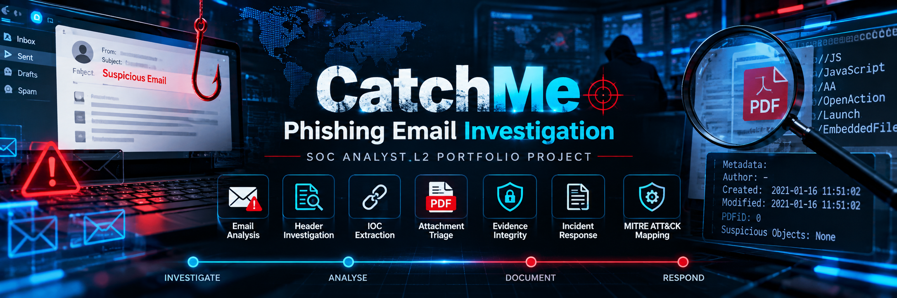

# Phishing Investigation Projects


A collection of practical phishing investigation projects focused on email analysis, threat hunting, evidence handling, incident response, and detection engineering. The repository is organized to demonstrate a repeatable SOC workflow—from initial triage through investigation, documentation, and response recommendations.

> **Purpose:** Cybersecurity learning and portfolio development. Use only authorized environments, approved tools, and lawfully obtained samples. Findings in individual projects are limited to the evidence documented in that project.

## Objectives

- Investigate suspicious emails and potential brand impersonation.
- Analyze email headers, sender domains, and SPF/DKIM/DMARC results.
- Extract and assess URLs, domains, IP addresses, file hashes, and attachments.
- Preserve evidence and document integrity using cryptographic hashes.
- Correlate available email, endpoint, network, and identity telemetry.
- Develop and validate hunting queries and detection ideas.
- Apply incident-response practices, severity assessment, and escalation.
- Document findings, limitations, indicators, and lessons learned clearly.

## Repository Structure

The exact contents may vary by project. A typical layout is:

```text
Phishing-Projects/
├── README.md
├── Playbook.md
├── Runbook.md
├── Incident-Response-Report.md
├── Investigation-Timeline.md
├── Evidence-Register.md
├── IOC-Register.csv
├── MITRE-ATTACK-Mapping.md
├── lessons-learned.md
├── analysis/
│   ├── evidence-timeline.csv
│   └── indicator-inventory.csv
├── detections/
│   └── elastic-kql/
├── public-evidence/
├── references/
├── scripts/
└── assets/
    └── diagrams/
```

Files and folders are included only when relevant to a particular investigation.

## Standard Investigation Workflow

1. **Intake and preservation** — Record the report, preserve the original message, calculate SHA-256, and create a case record.
2. **Email analysis** — Review message headers, sender and reply domains, authentication results, message content, and contextual anomalies.
3. **URL and attachment triage** — Extract indicators and inspect files using approved static-analysis methods. Use isolated analysis for any required dynamic testing.
4. **Threat hunting and scoping** — Search authorized telemetry for matching messages, indicators, recipients, and potential follow-on activity.
5. **Assessment** — Evaluate evidence strength, scope, user interaction, potential impact, and severity.
6. **Response** — Recommend or perform authorized containment and recovery actions, then verify the outcome.
7. **Documentation** — Maintain the evidence register, IOC register, timeline, investigation report, and lessons learned.

## Documentation

Start with these operational guides:

- [Phishing Investigation Playbook](https://github.com/KdMenon007/Phishing-Projects/blob/main/01%20-%20CatchMe-Phishing-Investigation/Playbook.md) — overall investigation methodology, roles, decision points, and response principles.
- [Phishing Investigation Runbook](https://github.com/KdMenon007/Phishing-Projects/blob/main/01%20-%20CatchMe-Phishing-Investigation/Runbook.md) — step-by-step analyst workflow, evidence hashing, escalation criteria, containment decisions, and closure checks.

> If your repository uses different filenames or stores these documents in a subfolder, update the links to match the exact GitHub paths.

Where available, each project may include:

| Document | Purpose |
|---|---|
| Playbook | Investigation methodology, roles, decision points, and response principles |
| Runbook | Operational steps, commands, checks, and escalation criteria |
| Incident response report | Findings, impact assessment, actions, and disposition |
| Investigation timeline | Ordered events and analyst activities |
| Evidence register | Evidence sources, collection details, and integrity information |
| IOC register | Indicators with context, source, status, and confidence |
| MITRE ATT&CK mapping | Evidence-supported technique mapping |
| Detection content | Hunting queries or detection logic with field and validation notes |
| Lessons learned | Gaps, improvements, and follow-up actions |

## Evidence Handling and Safety

- Preserve original evidence separately from working copies.
- Record SHA-256 hashes, collection details, and any transformations.
- Label sanitized or redacted files as **public derivatives**, not original evidence.
- Do not publish personal data, credentials, tokens, internal addresses, confidential headers, or unredacted sensitive samples.
- Do not open suspicious links or execute attachments on a normal workstation.
- Use approved, isolated environments for dynamic analysis.
- Do not upload sensitive samples to public scanning services without authorization.
- Treat threat-intelligence and reputation results as contextual evidence, not definitive proof.

## Analysis Principles

- Separate **observed facts**, **analyst assessment**, and **unverified hypotheses**.
- SPF, DKIM, or DMARC passing does not prove that a sender is authorized to represent a brand or that a message is benign.
- A suspicious display name or domain mismatch is an indicator to investigate, not proof on its own.
- Static analysis can identify suspicious features, but the absence of those features does not guarantee a file is safe.
- A missing log source or unavailable telemetry means the activity could not be assessed; it does not prove that no activity occurred.
- Map MITRE ATT&CK techniques only when supported by evidence. Label uncertain mappings as candidates.
- Validate queries against the actual data source, field mappings, and known events before treating them as detections.

## Tools and Technologies

Projects may use relevant tools for:
- Email and MIME/header analysis
- File identification, hashing, and static analysis
- URL parsing and passive domain/IP research
- SIEM searches and threat-hunting queries
- Endpoint, network, and identity log correlation
- Evidence tracking and incident reporting

The tools used and the validation performed should be documented in each project. Listing a tool or query does not imply that it was run successfully or that its results were independently validated.

## Project Status and Limitations

Each investigation should state:
- Which evidence was actually available and examined.
- Which queries, tools, and checks were executed.
- Whether results were independently verified.
- What telemetry or context was unavailable.
- Which conclusions are confirmed, likely, possible, or undetermined.
- Which response actions were completed, recommended, or not performed.

Do not infer compromise, credential theft, malware execution, or successful containment unless the evidence supports that conclusion.

## Intended Audience

This repository is intended for SOC analysts, incident responders, detection engineers, and cybersecurity learners who want to practice structured phishing investigation and incident documentation.

## Disclaimer

These projects are for educational, defensive, and portfolio purposes. They are not a substitute for an organization's approved incident-response procedures. Conduct all analysis within the scope of explicit authorization and applicable law.

---

**Maintained as a cybersecurity investigation portfolio.**
