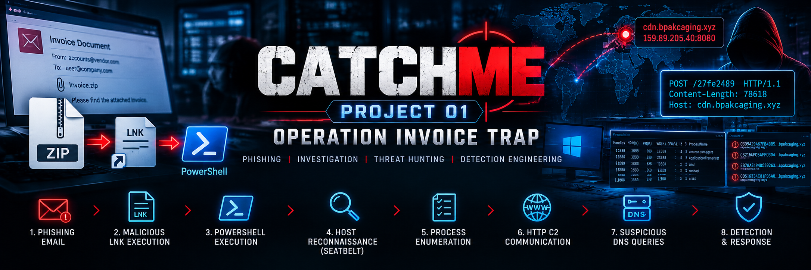
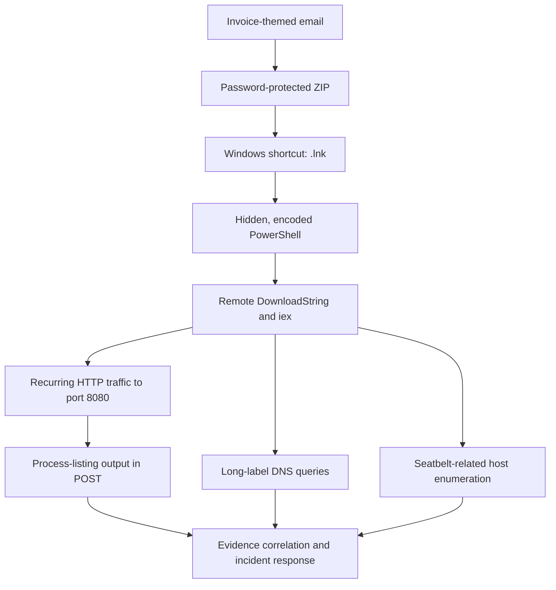

# CatchMe Project 04 — Operation Invoice Trap

**Role focus:** SOC Analyst L2 / Senior SOC Analyst  
**Investigation type:** Phishing triage, Windows endpoint investigation, network traffic analysis, detection engineering  
**Environment:** Authorized training lab; Windows endpoint telemetry and PCAP evidence

## Executive summary

An invoice-themed email addressed to finance employee Julianne Westcott contained a password-protected ZIP attachment. The archive contained a Windows shortcut (`.lnk`) that launched hidden, encoded PowerShell. Decoding the command revealed a remote `DownloadString()` followed by `Invoke-Expression` (`iex`).

Correlated PowerShell logs and packet-capture evidence show subsequent PowerShell activity, recurring HTTP communications to `cdn.bpakcaging.xyz:8080`, process-listing output in an HTTP POST, and repeated long-label DNS queries under `bpakcaging.xyz`. PowerShell logs also record Seatbelt-related commands consistent with host reconnaissance.

**Assessment:** High confidence of suspicious execution and command-and-control-like activity in the lab. Successful data exfiltration, credential theft, the exact remote payload contents, and DNS tunnelling are **not established** by the evidence reviewed.

## Investigation flow

## Key evidence

| Evidence | Observation | Interpretation / limitation |
|---|---|---|
| Email (`dump.eml`) | Invoice lure; sender `agriffin@bpakcaging.xyz`; attachment password `Invoice2023!` | Phishing-like delivery; authentication passes alone do not establish legitimacy |
| ZIP / LNK | `Invoice_20230103.lnk`; hidden encoded PowerShell; remote `DownloadString()` piped to `iex` | Strong suspicious execution pattern |
| PowerShell logs | Event 4104 records initial command and later polling/command execution logic; Seatbelt-related activity appears later | Confirms script content was processed; individual command success must be assessed separately |
| HTTP PCAP | Repeated POSTs to `159.89.205.40:8080`, URI `/27fe2489`; one POST declared 78,618 bytes and received HTTP 200 | Supports C2-like communication; HTTP 200 does not prove successful exfiltration |
| HTTP POST output | Partial decoded output includes Windows process listing and DNS lookup errors | Supports host reconnaissance and transmission of command output; decoding of stream 1076 is partial |
| DNS PCAP | 88 unique long hexadecimal-label queries under `bpakcaging.xyz`; matching responses had zero answer records | Suspicious, but DNS tunnelling is not confirmed |

## Repository map

- `docs/` — phase-by-phase investigation
- `evidence/` — source-specific analyst notes
- `detections/` — detection logic, SIEM queries, ATT&CK mapping
- `timeline/` — correlated timeline CSV
- `assets/screenshots/` — email-analysis screenshots
- `assets/diagrams/` — attack-chain diagram source
- `reports/` — executive and technical reports
- `references/` — tools and documentation

## How to reproduce the analysis

1. Preserve the original artefacts and record SHA-256 hashes before analysis.
2. Inspect the raw email headers and attachment metadata.
3. Extract the ZIP in an isolated analysis environment and parse the `.lnk`; do not execute it.
4. Decode the PowerShell `-EncodedCommand` value as UTF-16LE and document the result as text only.
5. Correlate PowerShell Operational logs with packet timestamps.
6. Use Wireshark/TShark to inspect DNS, HTTP requests, TCP streams, and response codes.
7. Run the SIEM query templates in `detections/siem-queries.md` only after mapping them to the target data model.
8. Record validation results and false positives in `docs/08-Detection-Validation-Plan.md`.

## Detection engineering status

The SPL and KQL examples are **starter queries** and have not been executed against a connected Splunk or Elastic instance. They require field mapping, time-range tuning, and benign-baseline testing before production use. Validation steps are provided separately.

## MITRE ATT&CK coverage

Current evidence supports a cautious mapping to phishing attachment delivery, user execution of a malicious file, PowerShell, ingress tool transfer, web-protocol communications, process discovery, and system/network discovery where the relevant command evidence is present. See `detections/mitre-attack-mapping.md` for evidence and confidence per technique. DNS tunnelling and exfiltration techniques are deliberately not claimed as confirmed.

## Incident-response priorities

1. Isolate the affected host according to incident-response policy.
2. Preserve the email, ZIP, LNK, PowerShell logs, PCAP, and relevant endpoint artefacts.
3. Identify and scope other hosts/users with the same sender, domains, IP, URI, and shortcut/hash indicators.
4. Review persistence, credential access, and lateral movement evidence before declaring containment.
5. Block or monitor indicators only after checking whether they are lab-specific and whether they overlap legitimate services.
6. Document what is confirmed, suspected, and not established.

## Evidence handling and limitations

Preserve originals unchanged; work from copies and record hashes. Do not publish raw email, PCAP, or sensitive artefacts unless redistribution is authorized. The evidence reviewed does not prove successful credential theft, successful data exfiltration, the exact contents of the downloaded payload, or DNS tunnelling. Partial POST-body decoding should not be described as a complete reconstruction.

## Project outcome

This project demonstrates a repeatable SOC workflow: email triage → shortcut and script analysis → endpoint/network correlation → ATT&CK mapping → detection hypotheses → evidence-qualified incident reporting.
