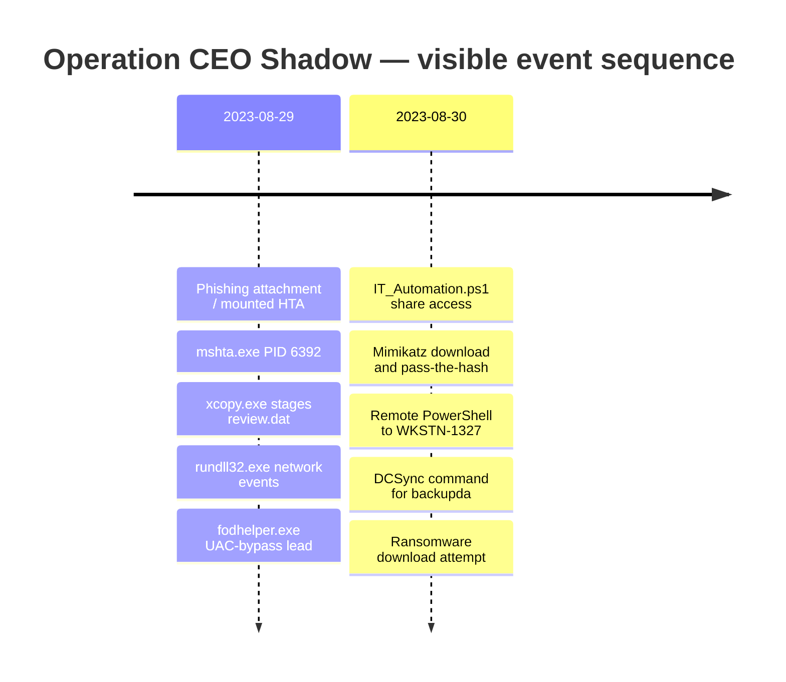

# Attack Timeline — Operation CEO Shadow

The times below are copied from visible Elastic fields and event messages. `UtcTime` appears in the process event details; confirm the lab timezone before converting timestamps. Do not treat search-hit counts as evidence of execution.

| Timestamp shown | Host | Process / artefact | Observation | Confidence and caveat |
|---|---|---|---|---|
| 2023-08-29 ~23:51:15.856 | `WKSTN-0051.quicklogistics.org` | `mshta.exe`, PID `6392` | Launched `D:\ProjectFinancialSummary_Q3.pdf.hta` | High for visible process event |
| 2023-08-29 23:51:16.738 | `WKSTN-0051.quicklogistics.org` | `xcopy.exe`, PID `3832` | Copied `D:\review.dat` to `C:\Users\EVAN~1.HUT\AppData\Local\Temp\review.dat` | High for visible command line; copy alone does not prove execution |
| 2023-08-29 ~23:51:17.910 onward | `WKSTN-0051.quicklogistics.org` | `rundll32.exe`, PID `4672` | Repeated connections to `165.232.170.151:80` | High for endpoint; C2 attribution remains an assessment |
| 2023-08-29 ~23:54:49.043 / .213 | `WKSTN-0051.quicklogistics.org` | `fodhelper.exe`, PIDs `5308` / `5180` | Parent context references `rundll32.exe D:\review.dat,DllRegisterServer` | Suspected UAC bypass; successful elevation unconfirmed |
| 2023-08-30 00:19:52.889 | `WKSTN-0051.quicklogistics.org` | PowerShell | Accessed `\\WKSTN-1327.quicklogistics.org\ITFiles\IT_Automation.ps1` | High for visible command line |
| 2023-08-30 01:29:09.409 | `WKSTN-1327.quicklogistics.org` | PowerShell | Downloaded Mimikatz ZIP from the GitHub release URL to `mimi.zip` | High for visible command line |
| 2023-08-30 01:30:25.545 | `WKSTN-1327.quicklogistics.org` | `mimikatz.exe`, PID `2056` | `sekurlsa::pth` targets `itadmin` | Process/username visible; hash redacted |
| 2023-08-30 01:40:37.178 | `WKSTN-0051.quicklogistics.org` | PowerShell | Creates a credential for `QUICKLOGISTICS\allan.smith` and invokes remote PowerShell on `WKSTN-1327` | Credential value redacted |
| 2023-08-30 01:43:57.673 | `WKSTN-1327.quicklogistics.org` | `mimikatz.exe`, PID `5096` | Pass-the-hash command targets `administrator` | Process/user visible; hash redacted |
| 2023-08-30 01:47:57.809 | `WKSTN-1327.quicklogistics.org` | Mimikatz | `lsadump::dcsync` targets `backupda` in `quicklogistics.org` | Command observed; successful replication unconfirmed |
| 2023-08-30 02:01:14.244 | Source host needs expanded-field confirmation; command targets `WKSTN-0051` | PowerShell | Attempts to download `ransomboogey.exe` to the CEO profile | Download attempt observed; execution/encryption unconfirmed |

## Timeline diagram

## Open timeline questions

- Identify the scheduled-task name and exact creation time from Security events 4698/4702 and Task Scheduler Operational logs.
- Export the direct process event for `rundll32.exe` loading `review.dat`.
- Verify source-host details for the ransomware-download command from the expanded event.
- Validate file creation, process start, file modifications, ransom notes, and recovery artefacts before concluding ransomware impact.
