# Executive Summary — Operation CEO Shadow

## Situation

Quick Logistics LLC's CEO, Evan Hutchinson, opened a suspicious financial-themed attachment and reported it after nothing visible happened. The attachment appeared as `ProjectFinancialSummary_Q3.pdf` but the mounted image exposed an HTML Application. Elastic telemetry was then used to reconstruct the observed activity across `WKSTN-0051.quicklogistics.org` and `WKSTN-1327.quicklogistics.org`.

## Assessment

The evidence supports a multi-stage intrusion sequence: HTA execution through `mshta.exe`, file staging with `xcopy.exe`, suspicious DLL invocation context involving `rundll32.exe`, repeated outbound connections, a suspected `fodhelper.exe` UAC-bypass sequence, credential-access and pass-the-hash activity, remote PowerShell execution, a DCSync command targeting `backupda`, and a ransomware-download attempt.

## Key findings

| Priority | Finding | Evidence / caveat |
|---|---|---|
| High | `mshta.exe` PID `6392` launched `D:\ProjectFinancialSummary_Q3.pdf.hta` | Screenshot-backed process event |
| High | `xcopy.exe` PID `3832` staged `D:\review.dat` in the CEO profile's Temp directory | Copy command line visible; execution of the copy needs direct-event confirmation |
| High | `rundll32.exe` PID `4672` connected repeatedly to `165.232.170.151:80` | Endpoint observed; C2 attribution is an assessment pending corroboration |
| High | Mimikatz pass-the-hash activity targeted `itadmin` and later `administrator` | Credential values redacted in public release; authentication success should be correlated |
| High | DCSync command targeted `backupda` in `quicklogistics.org` | Command observed; verify success with domain-controller audit events |
| High | PowerShell attempted to retrieve `ransomboogey.exe` | Download attempt is visible; successful execution or encryption is not established |
| Open | Scheduled-task name | Not present in the supplied screenshots |

## Attack-chain visualization

```mermaid
flowchart LR
    A[Phishing attachment] --> B[HTA via mshta.exe]
    B --> C[review.dat copied]
    C --> D[rundll32.exe / network activity]
    D --> E[Suspected fodhelper UAC bypass]
    E --> F[SMB share / IT_Automation.ps1]
    F --> G[Mimikatz and pass-the-hash]
    G --> H[PowerShell remoting]
    H --> I[DCSync: backupda]
    I --> J[Ransomware download attempt]
    J --> K[Impact not confirmed]
```

## Business impact

The supplied evidence indicates potentially serious endpoint and identity compromise. However, it does not establish data theft, successful domain-secret replication, ransomware execution, or file encryption. The correct incident status is **suspected multi-stage compromise with high-risk credential and Active Directory activity; ransomware impact unconfirmed**.

## Recommended actions

1. Preserve full Elastic event JSON and relevant email/attachment artefacts.
2. Investigate and contain the two hosts through the approved incident-response process if this were a live environment.
3. Review and rotate potentially exposed credentials, revoke active sessions, and audit privileged accounts.
4. Investigate `165.232.170.151`, `ff.sillytechninja.io`, SMB, WinRM, PowerShell, scheduled-task, and domain-controller telemetry.
5. Confirm whether `ransomboogey.exe` was created, executed, or caused file changes before stating ransomware impact.

**Evidence base:** 23 supplied screenshots, indexed in [`screenshots/README.md`](screenshots/README.md). Findings should be validated against raw event exports before being represented as a production incident conclusion.
