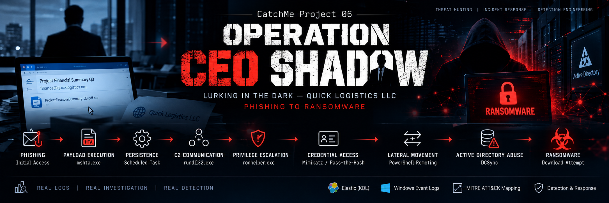
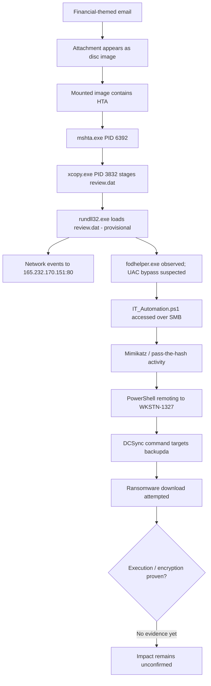

# CatchMe Project 06 — Operation CEO Shadow

**Scenario:** *Lurking in the Dark* — Quick Logistics LLC  
**Investigation type:** Multi-stage SOC / threat-hunting case study  
**Platform:** Elastic Discover with `winlogbeat-*` process-creation and network telemetry  
**Observed activity window:** 29–30 August 2023 (timestamps shown as UTC fields in event messages; confirm the lab timezone before conversion)

> **Executive finding:** The supplied evidence supports a phishing/HTA execution chain, staging of `review.dat`, suspicious `rundll32.exe` network activity, a suspected `fodhelper.exe` UAC-bypass sequence, credential-access and pass-the-hash activity, remote PowerShell execution, a DCSync command targeting `backupda`, and a ransomware-download attempt. It does **not** prove that ransomware executed successfully or encrypted files.

## Start here

| Resource | Purpose |
|---|---|
| [Executive Summary](Executive-Summary.md) | Fast read for recruiters and SOC reviewers |
| [Incident Response Report](Incident-Response-Report.md) | Full incident narrative, findings, limitations, and response plan |
| [Attack Timeline](Attack-Timeline.md) | Time-ordered evidence table and timeline diagram |
| [Question / Answer Tracker](Question-Answer-Tracker.md) | Scenario questions, grounded answers, and open items |
| [Project Status](PROJECT-STATUS.md) | Confirmed, provisional, and unresolved findings |
| [Evidence Register](Evidence-Register.csv) | Screenshot and outstanding-evidence index |
| [Screenshot Index](screenshots/README.md) | Captions for all 23 supplied screenshots |
| [MITRE ATT&CK Mapping](docs/12-mitre-attack-mapping.md) | Technique mapping with confidence and caveats |
| [Detection Coverage](detections/detection-coverage.md) | Detection opportunities and validation status |
| [Elastic KQL Queries](queries/elastic-kql/) | Search pivots used to investigate the event chain |

## Attack-chain overview

## Investigation method

1. **Scope and preserve:** identify the relevant hosts, timeframe, attachment, and event sources; preserve original screenshots and export raw event JSON where possible.
2. **Build the process chain:** correlate timestamps, PID, parent process, command line, process GUID, and host.
3. **Pivot across telemetry:** network connections, SMB access, PowerShell, authentication, and Active Directory audit events.
4. **Map behavior cautiously:** map ATT&CK techniques only where the observed behavior supports the technique; label uncertain stages as provisional.
5. **Validate impact:** distinguish a command or attempt from successful execution, credential use, directory replication, or encryption.

## Key evidence snapshot

| Finding | Evidence-based value | Confidence / limitation |
|---|---|---|
| Initial HTA process | `mshta.exe`, PID `6392`, `D:\ProjectFinancialSummary_Q3.pdf.hta` | Visible process-creation event |
| Staged file | `D:\review.dat` → `C:\Users\EVAN~1.HUT\AppData\Local\Temp\review.dat` | `xcopy.exe` PID `3832`; copy is not proof of execution |
| Suspected implant invocation | `rundll32.exe` with `review.dat` in parent-command context | Provisional; confirm the direct process-creation event and full command line |
| Network endpoint | `165.232.170.151:80` | Repeated network events; C2 attribution remains an assessment |
| UAC bypass lead | `fodhelper.exe` | Attempt is suspected; successful elevation is unconfirmed |
| Remote share file | `IT_Automation.ps1` on `\\WKSTN-1327.quicklogistics.org\ITFiles` | Visible PowerShell command line |
| DCSync target | `backupda` | Command observed; successful replication needs domain-controller audit corroboration |
| Ransomware URL | `http://ff.sillytechninja.io/ransomboogey.exe` | Download attempt observed; execution/encryption unconfirmed |

## Public-release hygiene

- The 23 screenshots are included under `screenshots/` and indexed in `screenshots/README.md`.
- The plaintext lab password and complete NTLM hashes are redacted from the public-facing screenshot set and documentation.
- Do not add raw credentials, tokens, unredacted event exports, or sensitive customer data to a public repository.
- The screenshots are evidence snapshots, not a substitute for original event JSON. Several Discover views use a time picker extending into 2026; narrow searches to the 2023 incident window when reproducing results.

## Repository layout

See [`PROJECT-TREE.txt`](PROJECT-TREE.txt) for the packaged folder structure. The package preserves the requested project organization and adds investigation diagrams and detailed ATT&CK / detection tables.
