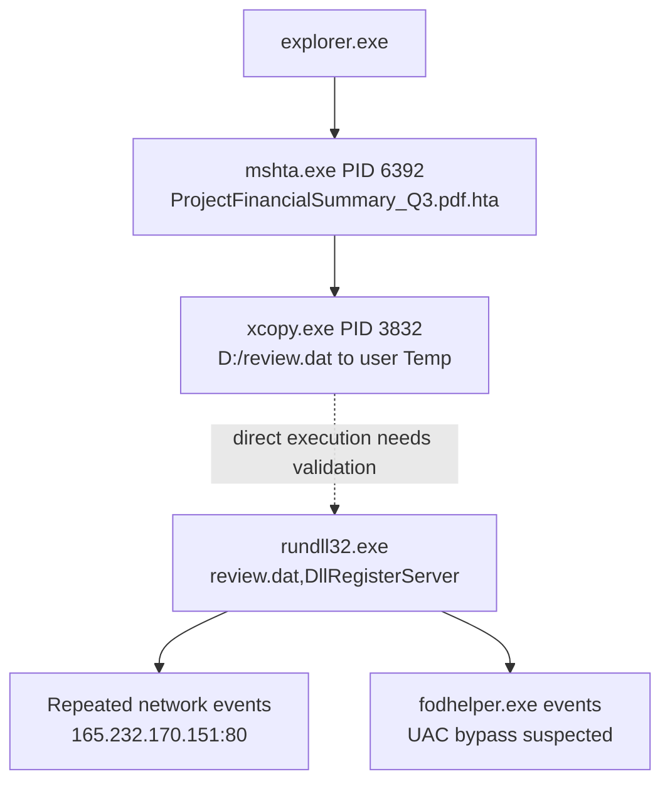

# 03 — Stage-One Payload Analysis

Elastic Discover search for `ProjectFinancialSummary_Q3.pdf` returned four hits. A visible process-creation event on `WKSTN-0051.quicklogistics.org` at `2023-08-29 23:51:15.856` identifies `mshta.exe`, PID `6392`, parent `explorer.exe`, with a command line referencing `D:\ProjectFinancialSummary_Q3.pdf.hta`.

A visible event at `2023-08-29 23:51:16.738` shows `xcopy.exe`, PID `3832`, parent `mshta.exe`, copying `D:\review.dat` to `C:\Users\EVAN~1.HUT\AppData\Local\Temp\review.dat`.

Copy command line: `"C:\Windows\System32\xcopy.exe" /S /i /e /h D:\review.dat C:\Users\EVAN~1.HUT\AppData\Local\Temp\review.dat`

Next: inspect expanded event details and search for a later process execution referencing the destination path. The copy event alone does not prove execution.

## Latest evidence — implanted-file invocation (provisional)
Screenshot `09-elastic-fodhelper-rundll32-review-dat-uac-bypass.png` shows `fodhelper.exe` PIDs 5308 and 5180. The displayed parent is `rundll32.exe`, and the parent command line is `"C:\Windows\System32\rundll32.exe" D:\review.dat,DllRegisterServer`. This is evidence that `review.dat` was passed to `rundll32.exe`; inspect the expanded event JSON before treating this as the final answer to Q3.

## Process-chain diagram

The dotted edge is intentionally labelled as a validation gap: the available screenshot shows the invocation in parent-command context, not a separate expanded process event for `rundll32.exe`.
