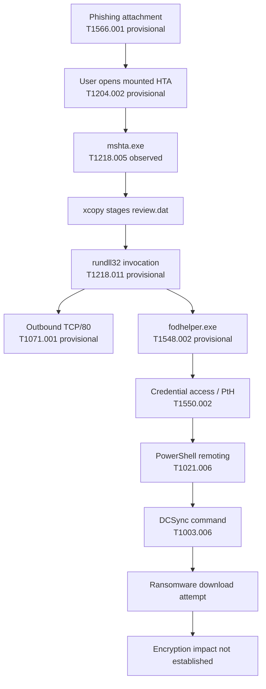

# 12 — MITRE ATT&CK Mapping

This is an evidence-led mapping for the observed behavior, not a claim that every attack step succeeded. Technique IDs and names should be checked against the current MITRE ATT&CK Enterprise matrix before a formal publication. **Observed** means the behavior is visible in supplied screenshots; **Provisional** means the behavior is consistent with a technique but needs corroboration; **Not established** means do not report the technique as a confirmed outcome.

| Tactic | Technique | Evidence in this case | Status | Validation needed |
|---|---|---|---|---|
| Initial Access | **T1566.001 — Spearphishing Attachment** | Financial-themed email and suspicious attachment shown in screenshots 01–03 | Provisional | Original email headers, attachment metadata, delivery path |
| Execution | **T1204.002 — User Execution: Malicious File** | Scenario evidence indicates CEO opened the attachment | Provisional | User activity / original artefact timeline |
| Execution | **T1218.005 — Mshta** | `mshta.exe` PID 6392 launched the `.hta` path | Observed | Full raw process event and file metadata |
| Execution | **T1218.011 — Rundll32** | Parent command context shows `rundll32.exe D:\review.dat,DllRegisterServer` | Provisional | Direct `rundll32.exe` process-creation event |
| Defense Evasion / Privilege Escalation | **T1548.002 — Bypass User Account Control** | `fodhelper.exe` process events appear in the suspected chain | Provisional | Integrity/token evidence and complete process tree |
| Command and Control | **T1071.001 — Web Protocols** | Repeated connections to TCP/80 from `rundll32.exe` | Provisional | HTTP metadata, proxy/firewall/DNS or packet corroboration |
| Command and Control | **T1105 — Ingress Tool Transfer** | PowerShell command downloads the Mimikatz ZIP from GitHub | Observed as a download command | Confirm transfer completion and resulting file hash |
| Credential Access | **T1550.002 — Pass the Hash** | Mimikatz `sekurlsa::pth` commands target `itadmin` and `administrator` | Observed as command activity | Correlate authentication/logon events to determine success |
| Lateral Movement | **T1021.006 — Windows Remote Management** | PowerShell `Invoke-Command` and second-host `wsmprovhost.exe` | Observed / high confidence | WinRM and PowerShell Operational logs; confirm remote action outcomes |
| Lateral Movement | **T1021.002 — SMB/Windows Admin Shares** | `IT_Automation.ps1` accessed over an SMB share | Provisional only | The observed share is `ITFiles`, not an identified administrative share; validate technique fit before using this ID |
| Credential Access | **T1003.006 — OS Credential Dumping: DCSync** | Mimikatz `lsadump::dcsync` targets `backupda` | Observed as command activity | Domain-controller audit events and replication outcome |
| Persistence | **T1053.005 — Scheduled Task** | Scenario question asks about a task; no task name/event is visible in the supplied screenshots | Not established | Security 4698/4702 and Task Scheduler Operational events |
| Impact | **T1486 — Data Encrypted for Impact** | Ransomware download command is visible | Not established | Process execution, file-write/rename telemetry, ransom notes, encryption evidence |

## ATT&CK-oriented attack-chain diagram

## Mapping rules applied

- Do not map a technique merely because it appears in a scenario question or narrative.
- Distinguish **command observed**, **action attempted**, **action completed**, and **impact confirmed**.
- The local `xcopy.exe` operation is a file copy; by itself it is not evidence of ATT&CK Ingress Tool Transfer.
- A connection to TCP/80 is not enough to prove HTTP C2. Use the network technique only as a provisional analytic hypothesis until protocol-level evidence is available.
