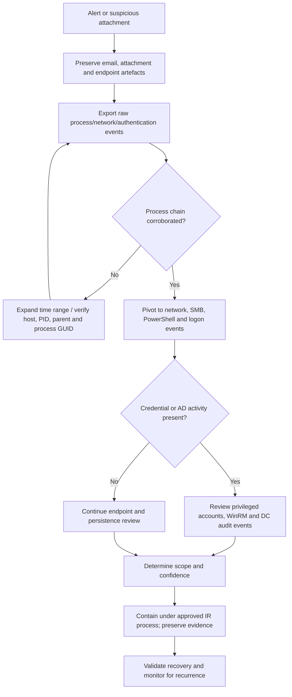

# 13 — Detection and Response Playbook

## Triage flowchart

## Priority triage checklist

| Priority | Action | Evidence / output |
|---|---|---|
| P1 | Preserve original email, attachment, mounted-image contents and endpoint artefacts | Original files, metadata, hashes, chain of custody |
| P1 | Export full Elastic events around 29–30 August 2023 | JSON/NDJSON with host, timestamp, PID, parent, command line, process GUID and event ID |
| P1 | Scope `mshta.exe`, `xcopy.exe`, `rundll32.exe`, `fodhelper.exe`, PowerShell and `mimikatz.exe` | Process tree and event-to-event timeline |
| P1 | Investigate `165.232.170.151:80` and `ff.sillytechninja.io` | DNS, proxy, firewall, network flow and HTTP metadata |
| P1 | Review privileged account use, pass-the-hash attempts and remote sessions | Authentication, logon type, account, source host, target host and result |
| P1 | Validate DCSync activity | Domain-controller Security events and replication-rights changes |
| P2 | Confirm persistence | Scheduled-task events 4698/4702 and Task Scheduler Operational log |
| P2 | Confirm ransomware impact | File creation, process execution, file modifications, ransom notes and backup status |
| P2 | Document containment and recovery | Action log, owner, timestamp, evidence preserved, validation result |

## Evidence preservation sequence

1. Record host, user, collection time, time zone, and collection method.
2. Preserve original artefacts read-only where feasible; calculate SHA-256 hashes.
3. Export raw events before changing retention or remediating the host.
4. Store public-safe copies separately from private unredacted lab evidence.
5. Record each conclusion with evidence ID and confidence level.

## Containment guidance for a real incident

Use the organization's approved incident-response process. Consider isolating affected endpoints, blocking confirmed malicious infrastructure, revoking sessions, rotating potentially exposed credentials, reviewing privileged accounts, and preserving memory/disk evidence where operationally appropriate. Do not execute or retrieve the ransomware sample as part of this portfolio exercise.
