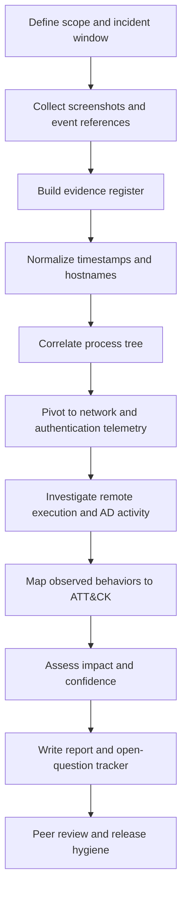

# 16 — Investigation Workflow, Evidence Model, and Reporting

## Investigation workflow

## Evidence confidence model

| Label | Meaning | Reporting language |
|---|---|---|
| Observed | Directly visible in a supplied screenshot or event field | “The event shows…” |
| Correlated | Two or more related records align by host/time/process identity | “Correlated telemetry indicates…” |
| Provisional | Plausible interpretation but a key artefact is missing | “Consistent with…” / “Suspected…” |
| Not established | Evidence does not currently support the conclusion | “Not confirmed by supplied evidence” |

## Minimum evidence fields for a process-chain record

| Field | Why it matters |
|---|---|
| `@timestamp` / event `UtcTime` | Time ordering and timezone validation |
| `host.name` | Host-scoped investigation |
| `process.pid` and `process.entity_id` / GUID | Process correlation; PID alone may be reused |
| `process.name` and `process.executable` | Process identity |
| `process.command_line` / `process.args` | Intent and execution context |
| `process.parent.name`, PID and command line | Parent-child relationship |
| `event.code` / `winlog.event_id` | Event type and telemetry source |
| `destination.ip`, `destination.port` | Network pivot |
| `user.name`, logon ID, authentication result | Account and session correlation |

## Reporting quality checklist

- [ ] Every material claim points to a screenshot/evidence ID or raw event.
- [ ] The distinction between observed behavior and inferred intent is explicit.
- [ ] The incident timezone is documented.
- [ ] Secrets and reusable credentials are redacted from public artefacts.
- [ ] ATT&CK mappings include a confidence qualifier.
- [ ] Download attempts are not described as successful execution without proof.
- [ ] Ransomware impact is not claimed without file/process/impact evidence.
- [ ] Open questions and collection gaps are preserved in the final report.
